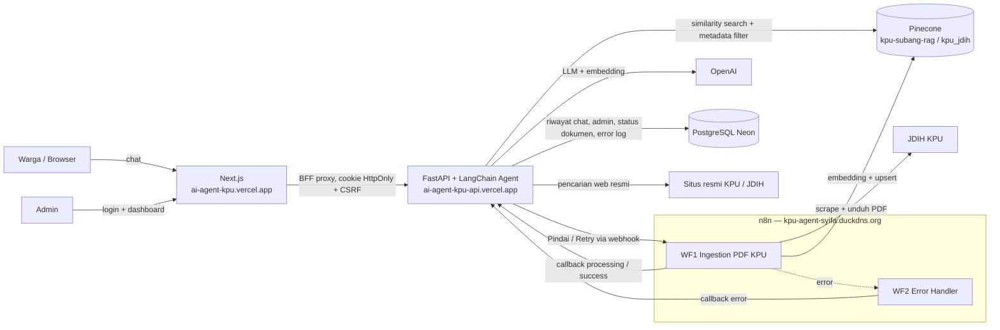

# AI Agent Informasi Kepemiluan — KPU Kabupaten Subang

AI Agent yang menjawab pertanyaan masyarakat tentang kepemiluan **berdasarkan dokumen resmi JDIH KPU**, dengan sumber rujukan di bawah setiap jawaban. Workflow n8n mendeteksi peraturan baru di JDIH KPU setiap hari, lalu mengunduh dan mengindeksnya ke Pinecone. Admin memantau dan mengendalikan seluruh prosesnya dari dashboard.

| | Tautan |
| --- | --- |
| Aplikasi publik (chat) | https://ai-agent-kpu.vercel.app |
| Dashboard admin | https://ai-agent-kpu.vercel.app/admin/login |
| Backend API (health check) | https://ai-agent-kpu-api.vercel.app/health |

**Jalur capstone: P2 + P3**

---

## 1. Masalah yang diselesaikan

Masyarakat kesulitan menemukan jawaban pasti tentang aturan pemilu (syarat pemilih, pindah TPS, jadwal, kampanye):

- Aturannya tersebar di puluhan Peraturan KPU (PDF ratusan halaman) di JDIH KPU, sulit dicari dan dibaca orang awam.
- Chatbot umum sering **berhalusinasi**: menjawab meyakinkan tanpa sumber, atau memakai aturan yang sudah tidak berlaku.
- Petugas KPU menjawab pertanyaan berulang secara manual, dan memperbarui basis pengetahuan setiap kali ada peraturan baru juga manual.

**Kenapa perlu diotomasi:** KPU terus menerbitkan dan mengubah peraturan. Tanpa otomasi, basis pengetahuan cepat usang, dan jawaban yang usang tentang aturan pemilu bisa merugikan hak pilih warga.

## 2. Solusi

1. **Chat publik tanpa login.** Warga bertanya dengan bahasa sehari-hari ("cara pindah tps", "syarat jadi pemilih apa aja?"). Agent mencari Pasal yang relevan di Pinecone dan situs resmi, lalu menjawab dengan sitasi `[1]`, `[2]` dan tautan ke sumbernya.
   - Hanya sumber yang benar-benar disitasi yang ditampilkan; dokumen PDF dan situs resmi dicantumkan bersama bila keduanya mendukung.
   - Sumber web dibatasi ke situs pemerintah: KPU RI, JDIH KPU, KPU Kabupaten Subang, Pemkab Subang, Pemprov Jawa Barat (mis. Pilkades digital/e-voting), JDIH BPK dan Kemendagri.
   - Pertanyaan data per penyelenggaraan tanpa tahun (mis. "siapa ketua KPPS TPS 05?") dijawab dengan pertanyaan klarifikasi; data pemilihan yang belum terjadi dijawab "belum ada".
   - Menu dan tautan **layanan resmi KPU**: Cek DPT Online, Info Pemilu (profil calon/partai), hasil Pemilu dan Pilkada 2024, JDIH, PPID, e-PPID KPU Subang, serta portal Pemkab Subang.
   - Jawaban tampil rapi: huruf **tebal**/*miring* tanpa simbol bintang, daftar bernomor, dan tautan sitasi.
2. **Guardrail anti-halusinasi.**
   - Jawaban faktual wajib bersitasi dari sumber yang benar-benar ditemukan tool. Kalau tidak ada sitasi yang valid, agent menjawab "belum dapat memastikan".
   - Hanya dokumen berstatus berlaku (atau belum diverifikasi, dengan catatan) yang dipakai; dokumen dicabut dikecualikan.
   - Pertanyaan di luar topik kepemiluan ditolak dengan sopan.
   - Isi dokumen diperlakukan sebagai data, bukan instruksi (perlindungan dari prompt injection).
   - Data pribadi (NIK, email, nomor HP) ditolak sebelum diproses.
3. **Ingestion otomatis (n8n WF1).** Setiap hari pukul 06.00, WF1 memindai JDIH KPU, mendeteksi PDF peraturan baru, mengekstrak teks aslinya, membuat embedding, menyimpannya ke Pinecone, dan melaporkan status ke dashboard.
4. **Error handling (n8n WF2).** Setiap kegagalan WF1 dicatat ke dashboard admin, lengkap dengan node dan pesan error, dan bisa di-*retry* dari dashboard.
5. **Dashboard admin.**
   - Jumlah dokumen, chunk hasil embedding, dan Pasal terindeks.
   - Status per dokumen (processing / success / failed) beserta konfirmasi Pinecone.
   - Daftar workflow dan eksekusi n8n.
   - Error log dengan alert.
   - Tombol **Pindai JDIH sekarang** dan **Ingest PDF ini** (dengan judul opsional).
   - Alert error yang hilang setelah dicek dan muncul lagi hanya bila ada error baru.
   - Lupa kata sandi: kode verifikasi 6 digit dan tautan reset dikirim ke email admin (butuh konfigurasi SMTP).
6. **Tampilan.** Warna mengikuti logo KPU (merah-emas), tema terang/gelap, responsif di HP dengan tombol sidebar, sidebar tidak ikut bergulir, kolom ketik selalu terlihat, dan pesan error menyertakan kode HTTP.

## 3. Arsitektur



### Alur chat (input → hasil)

1. Warga mengetik pertanyaan. Frontend Next.js meneruskannya ke FastAPI melalui proxy server-side, sehingga API key tidak pernah sampai ke browser.
2. Backend memeriksa data pribadi, rate limit, dan maksud pertanyaan (sapaan / kepemiluan / di luar topik).
3. Agent LangChain memanggil tool `search_kpu_documents`: embedding pertanyaan, lalu mencari di Pinecone dengan filter status hukum dan relevansi. Bila perlu, agent juga memanggil `search_web_resmi`, yang hanya menelusuri domain resmi KPU.
4. Jawaban disusun ulang **hanya dari kutipan yang ditemukan**. Sitasi divalidasi: ID sumber yang tidak ada akan memicu jawaban "belum dapat memastikan".
5. Frontend menampilkan jawaban, sitasi yang bisa diklik, dan daftar **Sumber rujukan** (Dokumen PDF / Situs resmi).

### Alur ingestion (n8n WF1)

```
Jadwal 06.00 / tombol admin ─► JDIH KPU (PKPU) + koleksi Keputusan KPU Kabupaten Subang
  ─► halaman detail (judul + status) ─► hanya status Berlaku, tahun 2024–2026
  ─► sudah pernah diproses? (cek PostgreSQL) ─► unduh PDF ─► hash SHA-256 ─► callback "processing"
  ─► ekstrak teks: PDF digital = teks asli; PDF scan / gagal dibaca = transkripsi LLM ke Markdown
  ─► potong per Pasal/diktum ─► embedding OpenAI ─► upsert Pinecone + metadata ─► callback "success"
Error di node mana pun ─► WF2 ─► error log di dashboard (bisa Retry)
```

Export workflow ada di [`KPU_AI_Agent_Terintegrasi/workflows/`](KPU_AI_Agent_Terintegrasi/workflows/), dengan panduan impor di [`workflows/README.md`](KPU_AI_Agent_Terintegrasi/workflows/README.md).

## 4. Teknologi

| Lapisan | Teknologi |
| --- | --- |
| AI / LLM | OpenAI (model chat via Responses API, dapat dikonfigurasi lewat `OPENAI_MODEL`), embedding `text-embedding-3-small` (1536 dimensi) |
| Agent & RAG | LangChain v1 `create_agent` (LangGraph), tool calling, Pinecone vector store, sintesis jawaban berbasis bukti dengan validasi sitasi |
| Otomasi | n8n: Schedule & Webhook Trigger, HTTP Request, Extract from File, Crypto, Pinecone Vector Store, Error Trigger |
| Backend | FastAPI, SQLAlchemy, Alembic, Pydantic Settings |
| Frontend | Next.js 15 (App Router), React 19, TypeScript |
| Data | PostgreSQL (Neon), Pinecone Serverless |
| Deploy | Vercel (frontend + backend), n8n self-hosted (Docker + Caddy di EC2) |

## 5. Struktur repositori

```
KPU_AI_Agent_Terintegrasi/
├── app/                    # Backend FastAPI: agent, RAG, guardrail, API admin
│   ├── agent/              # prompt sistem + tools (Pinecone, web resmi, e-PPID)
│   ├── rag/                # pencarian Pinecone + filter relevansi & status hukum
│   ├── services/           # ai_service (alur agent & validasi sitasi), monitor n8n
│   └── api/routes/         # chat, session, conversations, admin
├── kpu-ai-agent-nextjs/    # Frontend Next.js (chat publik + dashboard admin)
├── workflows/              # Export n8n WF1 & WF2 (tanpa credential)
├── scripts/                # ingest_jdih_awal.py, bootstrap_admin.py, dll.
├── alembic/                # migrasi database
├── tests/                  # pytest
├── infra/                  # Docker Compose + Caddy untuk n8n/self-host
└── DEPLOY_VERCEL.md        # konfigurasi deploy yang sedang berjalan
```

## 6. Cara menjalankan

### Prasyarat
- Python 3.12, Node.js 20+
- API key OpenAI, Pinecone (index dimensi 1536, metrik cosine), database PostgreSQL (mis. Neon)
- n8n (opsional untuk ingestion otomatis)

### Backend (lokal)
```bash
cd KPU_AI_Agent_Terintegrasi
python -m venv .venv && source .venv/bin/activate   # Windows: .venv\Scripts\Activate.ps1
pip install -r requirements-dev.txt
cp .env.example .env        # isi OPENAI_API_KEY, PINECONE_*, DATABASE_URL, SESSION_SECRET acak
alembic upgrade head
python -m scripts.bootstrap_admin admin@contoh.org   # akun admin pertama (password via prompt)
uvicorn app.main:app --reload                         # http://127.0.0.1:8000/health
```

### Frontend (lokal)
```bash
cd KPU_AI_Agent_Terintegrasi/kpu-ai-agent-nextjs
npm ci
cp .env.example .env.local  # FASTAPI_BASE_URL=http://127.0.0.1:8000, APP_ORIGIN=http://localhost:3000
npm run dev                 # http://localhost:3000 dan /admin/login
```

### Mengisi knowledge base
```bash
cd KPU_AI_Agent_Terintegrasi
python -m scripts.ingest_jdih_awal --pages 2 --backend http://127.0.0.1:8000
```
Setelah itu WF1 n8n mendeteksi peraturan baru setiap hari.

### n8n
Impor `workflows/WF2…json` lalu `workflows/WF1…json`, buat credential sesuai [`workflows/README.md`](KPU_AI_Agent_Terintegrasi/workflows/README.md), set WF2 sebagai Error Workflow WF1, lalu aktifkan keduanya.

### Deploy
Lihat [`DEPLOY_VERCEL.md`](KPU_AI_Agent_Terintegrasi/DEPLOY_VERCEL.md).

### Pengujian
```bash
cd KPU_AI_Agent_Terintegrasi && python -m pytest -q
cd kpu-ai-agent-nextjs && npm run lint && npx tsc --noEmit && npm run build
```

## 7. Hasil

- 21 Peraturan KPU resmi (2024–2026) dan Keputusan KPU Kabupaten Subang (mis. rekap data pemilih berkelanjutan per triwulan) terindeks: ±2.050 chunk berstatus berlaku, terkonfirmasi di Pinecone dan terpantau di dashboard.
- Contoh: "Berapa jumlah pemilih Kecamatan Subang triwulan III 2026?" dijawab **104.453 orang** dengan sitasi Keputusan KPU Kabupaten Subang No. 21/2026.
- Jawaban menyertakan nomor Pasal dan tautan PDF resmi. Pertanyaan tanpa bukti (mis. jadwal Pilkada 2029 yang aturannya belum terbit) dijawab "belum dapat memastikan", bukan dikarang.
- WF1 teruji end-to-end: webhook dari dashboard → n8n → Pinecone → status sukses di dashboard. Pemindaian ulang melewati dokumen yang sudah diproses.

## 8. Keamanan

- Tidak ada API key, token, password, atau `.env` di repositori. Semua secret disimpan di environment variable Vercel dan credential n8n. Export workflow hanya memuat nama credential.
- Admin: tanpa registrasi publik, password di-hash dengan scrypt, cookie sesi HttpOnly + Secure, CSRF token, pemeriksaan Origin, rate limit login, dan wajib ganti password pertama.
- Callback n8n → backend dan webhook backend → n8n diautentikasi dengan header secret terpisah.

## 9. Kendala & rencana pengembangan

**Kendala:**
- Sebagian produk hukum daerah belum diunggah ke situs resmi (mis. Perbup Subang 18/2026 tentang Tata Cara Pilkades Serentak), sehingga agent hanya dapat merujuk informasi resmi Pemprov Jawa Barat.
- Halaman JDIH tidak menyediakan API, sehingga judul dan status dibaca dari HTML.
- Waktu jawab 15–30 detik karena agent mencari dan memverifikasi sumber.

**Rencana:**
- Kanal Telegram/WhatsApp.
- Streaming jawaban.
- Evaluasi akurasi jawaban dengan dataset uji.
- Notifikasi email/Telegram untuk error.

---

Dokumentasi teknis rinci: [`KPU_AI_Agent_Terintegrasi/README.md`](KPU_AI_Agent_Terintegrasi/README.md) (backend), [`ADMIN_MONITORING.md`](KPU_AI_Agent_Terintegrasi/ADMIN_MONITORING.md) (admin & monitoring), [`workflows/README.md`](KPU_AI_Agent_Terintegrasi/workflows/README.md) (n8n).
